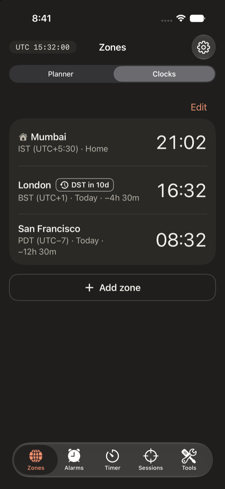
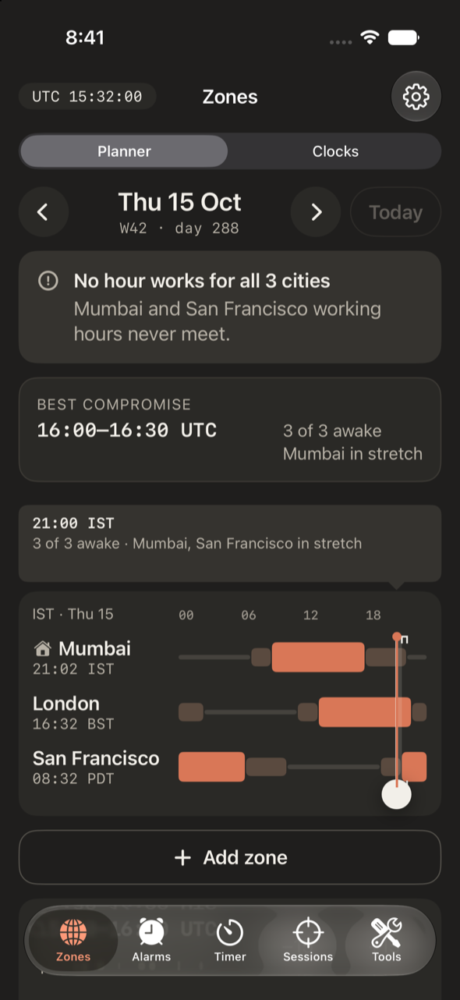
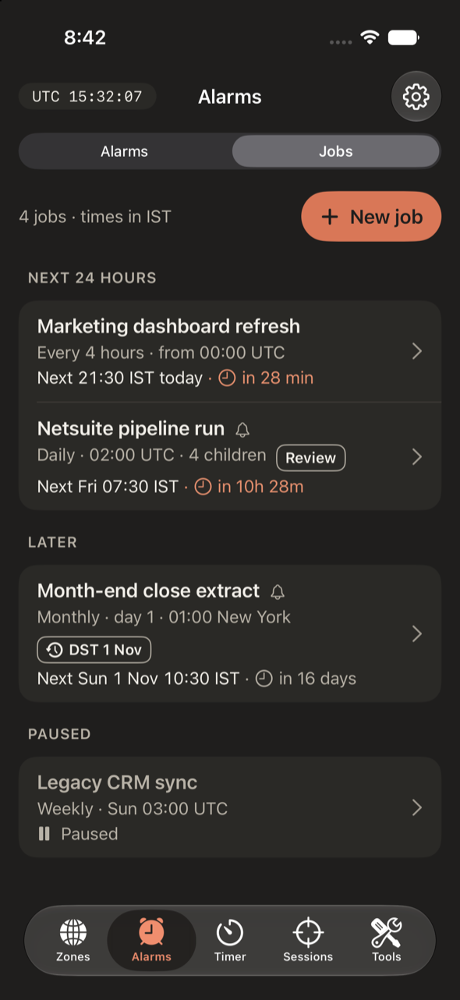
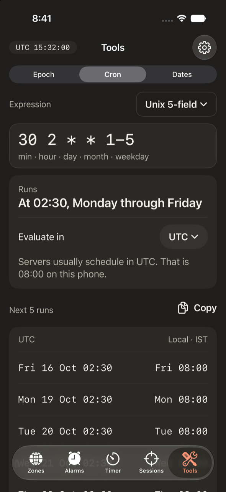

# Meridian

A native iPhone clock app for developers, data engineers, analysts and remote tech
workers. It replaces the iOS Clock app (world clock, alarms, timers, stopwatch) and
answers the time questions a global tech worker asks: *when can we all meet, what is
this timestamp, when does this job run in my time zone, what fiscal week is it?*

<p>
  
  
  
  
</p>

## Why Meridian

Meridian started from a data engineer's working day. Pipelines, notebooks and dashboard
refreshes run on schedules at different times of the day. The schedulers (Airflow,
Azure Data Factory, Microsoft Fabric, Databricks) usually think in UTC, the logs speak
in epoch timestamps, and the people who rely on the data sit in other time zones.

The iPhone's Clock app answers "what time is it in London?", but not the questions that
actually come up in that day:

- When does tonight's NetSuite pipeline run, on *my* clock?
- What moment is `1792060800000` in this log line?
- Is there any hour this week when Mumbai, London and San Francisco are all at work?
- Which fiscal week is it, and does this ISO week belong to last year or this one?

Answering them meant juggling a world-clock app, an epoch-converter website, a cron
explainer, a calendar and mental arithmetic, and the arithmetic is where the mistakes
happen. Meridian puts those answers in one native app. It also replaces the Clock app,
so there is still only one clock app on the phone.

## The problems it solves

**Time zones that never line up.** A world clock lists times; it doesn't show overlap.
A Mumbai working day (03:30–12:30 UTC) and a San Francisco one (16:00–01:00 UTC) never
meet, and three clocks in a list won't tell you that. The **Planner** draws every city's
work, stretch and sleep hours on one real timeline, finds the best window, and says
plainly when the best is only a compromise.

**Clocks that change on different dates.** Europe and the US move their clocks on
different weekends, so for about four weeks a year the London–San Francisco gap is 7
hours instead of 8, and recurring meetings and alarms quietly shift. Meridian applies
daylight saving automatically everywhere, shows a badge 14 days before a change, draws
23- and 25-hour days at their true length, and adds a one-line note whenever a result
moves.

**Schedules written in UTC, lived in local time.** `0 2 * * *` on a UTC server is 07:30
in India. Cron dialects disagree (Unix counts Sunday as 0, Quartz, used by Databricks,
as 1), and a local-time schedule can land on a time that doesn't exist (02:30 on
spring-forward day) or happens twice. The **Cron** tool explains an expression in
English, lists the next runs in UTC and local time side by side, and warns when a clock
change skips or repeats a run.

**Nobody remembers when every job runs.** Pipelines, notebook runs and dashboard
refreshes live in different tools, each with its own schedule screen. **Jobs** is a
personal schedule book: each job's schedule in its own zone, child steps with their
expected start times, a "Mirrors" note pointing at the real DAG or pipeline, and
optional reminders. It deliberately shows no run status: a phone can't know whether a
run succeeded, so it doesn't pretend to.

**Timestamps without context.** Logs, APIs and Kafka use epoch values in seconds,
milliseconds, microseconds or nanoseconds, and reading a 13-digit value as seconds (or
the reverse) is a classic bug: suddenly everything happened on 21 Jan 1970. Bare
abbreviations are no better: `IST` is India, Ireland or Israel, and `CST` is Central US,
China or Cuba. The **Epoch** tool detects the unit, converts exactly to the nanosecond
in both directions, asks which zone a zone-less date means, and every copied time
carries its offset: `17:00 BST (UTC+1)`.

**Alarms that should follow another clock.** A New York market open or a 02:00 UTC
deploy window is a time in someone else's zone, but the Clock app only knows the
phone's. Meridian's alarms can keep another zone's time or UTC, ring through Silent and
Focus, and tell you in advance when a clock change will move them.

**Reporting calendars.** Analysts report in ISO weeks and fiscal periods, and both have
traps. Mon 29 Dec 2025 belongs to ISO week `2026-W01`, so pairing a calendar year with
an ISO week number (Spark's `year()` with `weekofyear()`) gives wrong keys at every year
boundary. Fiscal years start in different months (India's on 1 April), and retail 4-4-5
calendars add a 53rd week every few years. The **Dates** tool shows ISO week, day of
year, quarter and fiscal period for any date, works backwards from a week or period to
its dates, and supports up to three fiscal calendars.

**Focus between calls.** Deep work happens in the gaps between meetings across zones.
**Sessions** runs a Pomodoro timer that knows when your next shared meeting window
starts, so you can finish a focus block before the call begins.

## Features

- **Zones.** Clocks for any IANA zone, with `BST (UTC+1)` labels, day offsets and a
  badge 14 days before a clock change. The **Planner** lays each city's work, stretch
  and sleep hours on the home zone's real day (23, 24 or 25 hours), finds the best
  meeting window, and says plainly when no hour works for everyone.
- **Alarms.** AlarmKit alarms that ring through Silent and Focus. An alarm can keep
  another zone's time ("09:00 New York, 18:30 IST on this phone"), and you choose what
  happens when that zone's clocks change: keep its wall time or keep UTC.
- **Jobs.** A schedule book for recurring work (pipelines, notebooks, dashboards):
  presets or Unix/Quartz cron, always shown in the job's own zone, with optional
  reminders. No run status: it records when things should run, not whether they did.
- **Timer.** Countdowns by duration or "until 02:00 UTC", a stopwatch with laps and
  CSV export, Live Activities and the Dynamic Island.
- **Sessions.** Pomodoro with a meeting line from your Planner zones.
- **Tools.** Epoch converter (seconds to nanoseconds, exact), cron explainer with next
  runs, and dates: ISO weeks, day of year and configurable fiscal calendars.
- **Widgets.** Home Screen widgets (Clock, Planner, Jobs) and Lock Screen accessories
  (next job, UTC).

## Time rules

Correctness is the product, so every screen follows the same rules:

- Instants are stored as UTC `Date`s; wall-clock schedules as components plus an IANA
  zone id. Never raw offsets or abbreviations.
- Days are counted with a calendar, never as 86,400 seconds: they can be 23 or 25 hours.
- A wall time that doesn't exist (clocks went forward) moves to the next valid time
  (02:30 → 03:00); one that happens twice uses the first occurrence unless you pick the
  second. Python's `zoneinfo` gives 03:30 for the skipped case; the difference is
  intentional.
- Copied times always carry the offset: `17:00 BST (UTC+1)`, never a bare `IST` or `CST`.
- Timers and the stopwatch store start and end instants, never a running counter.

The full rules are in [spec §5](docs/design/spec.md).

## Run it yourself

Meridian isn't on the App Store. It's open source: you build it from this repo and
install it on your own iPhone with Xcode. A free Apple ID is enough; you don't need the
paid Apple Developer Program.

### What you need

- A Mac with **Xcode 27** (iOS 27 SDK).
- An iPhone with **iOS 26.0 or later** (AlarmKit arrived in iOS 26), and a cable.
- An Apple ID. No third-party dependencies, nothing else to install.

### Try it in the Simulator

1. `git clone https://github.com/sinhashlok/meridian.git` and open `Meridian.xcodeproj`.
2. Pick the **Meridian** scheme and an iPhone Simulator, then Run (⌘R). No signing
   setup is needed for the Simulator.

Alarms, Live Activities, widgets and haptics need a real iPhone to judge properly.

### Install it on your iPhone

Each bundle id belongs to one Apple team, so you need your own team and ids before
Xcode will sign the app. They all live in one file, `Config/Signing.local.xcconfig`
(gitignored), which `Config/Signing.xcconfig` reads for all three targets. The bundle
ids, the App Group and the background refresh id are all built from it.

1. **Xcode › Settings › Accounts:** add your Apple ID. It appears as a "Personal Team".
   Select it, click **Manage Certificates…**, then **+ › Apple Development** (skip this if
   one is already listed).
2. Find your 10-character team id:
   ```bash
   security find-certificate -c "Apple Development" -p | openssl x509 -noout -subject
   ```
   It's the `OU=` value.
3. Create your signing file and set both values:
   ```bash
   cp Config/Signing.local.xcconfig.example Config/Signing.local.xcconfig
   ```
   ```
   MERIDIAN_TEAM = ABCDE12345
   MERIDIAN_ID_PREFIX = com.yourname
   ```
   The app becomes `com.yourname.meridian`, the widget
   `com.yourname.meridian.MeridianWidgets` and the App Group
   `group.com.yourname.meridian`. Xcode registers them the first time it signs.
   Don't pick a team in **Signing & Capabilities**: that writes it into the target and
   overrides this file. If you did, select the target, open **Build Settings**, find
   **Development Team** and choose **Edit › Delete**.
4. Choose **Product › Scheme › Edit Scheme › Run › Build Configuration: Release**
   (Debug is unoptimised and feels slow), connect the iPhone and Run.
5. **On the iPhone:** turn on **Settings › Privacy & Security › Developer Mode** when
   asked (it restarts), then trust your Apple ID under **Settings › General › VPN &
   Device Management**.
6. Allow alarms and notifications when Meridian asks.

Free Apple ID limits: the app stops opening after **7 days** (connect the phone and Run
again; your data stays), and you can have at most 3 such apps on a device at once. A
paid developer account raises this to a year.

`scripts/shoot.sh` reads the same file, so screenshots launch your bundle id.

## Tests

```bash
# Core logic (fast, no Simulator)
cd MeridianCore && swift test

# App build and UI accessibility audits in the Simulator (~5 min)
xcodebuild -project Meridian.xcodeproj -scheme Meridian \
  -destination 'platform=iOS Simulator,name=iPhone 17' -only-testing:MeridianUITests test
```

Every verified value in [`docs/design/fixtures.md`](docs/design/fixtures.md) is a Core
test. Debug builds accept launch arguments that open any screen with a frozen clock, for
screenshots: see `Meridian/App/DebugLaunch.swift` and `scripts/shoot.sh`.

## Project layout

```
Meridian/            App target (SwiftUI, SwiftData, AlarmKit, ActivityKit)
  App/               Entry point, tab shell, settings, sync services
  DesignSystem/      Tokens.swift (colours, fonts, spacing) and shared views
  Features/          Zones, Alarms (and Jobs), Timer, Sessions, Tools
MeridianWidgets/     Widget extension: widgets and Live Activities
Shared/              Code in both the app and the widget extension
MeridianCore/        Local Swift package: all time logic, Foundation only, unit-tested
MeridianUITests/     Accessibility audits
docs/                Spec, plan, decisions, design boards, notes
```

Views never do date maths themselves: they ask `MeridianCore`, which is how "DST handled
everywhere" stays true.

## Docs

- [Product and design spec](docs/design/spec.md) (wins over the design boards)
- [Plan and milestones](docs/PLAN.md)
- [Decisions](docs/decisions.md)
- [Design boards](docs/design/boards/) and [verified fixtures](docs/design/fixtures.md)
- [AlarmKit findings](docs/notes/alarmkit.md)

## Status

Milestones M0–M9 are done and checked on an iPhone. Meridian is released as open source
to build and run yourself; there are no App Store or TestFlight builds. Known open items
are in `CLAUDE.md` (Current state).

## Licence

[MIT](LICENSE) © 2026 Shlok Sinha. You may use, copy, modify and share it, including in
your own apps, as long as the copyright notice stays with it.

Issues and pull requests are welcome. Before changing time logic, read the
[time rules](docs/design/spec.md) and add a test to `MeridianCore`; every change must keep
`swift test` green.
